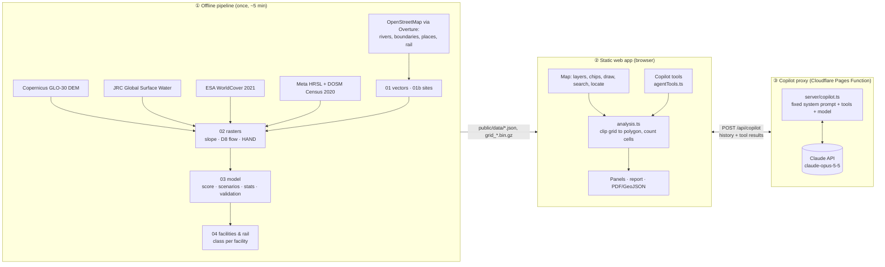
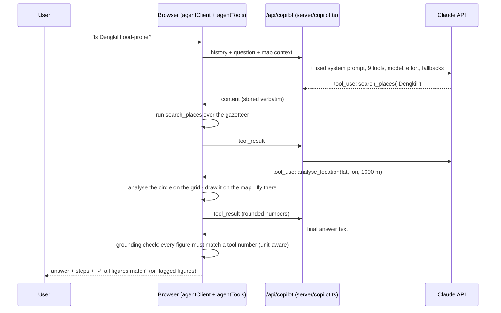

# Ginkgo — end-to-end architecture

Ginkgo is a flood-susceptibility command center for Selangor. It has three parts:

1. **An offline data pipeline** (Python, `pipeline/`) that turns open satellite, terrain, map and census data into small precomputed files.
2. **A static web app** (React + Leaflet, `src/`) that shows those files on a map and computes statistics for any area the user draws.
3. **An AI copilot** (Claude, behind a small server function) that answers questions by calling tools over the same computed data, and never produces a number itself.



## ① Offline pipeline

| Step | Input | Output |
|---|---|---|
| `01_vectors.py` | Overture divisions + water (range-read from S3) | 9 daerah boundaries (KL/Putrajaya excluded), rivers, 1,573-name gazetteer |
| `01b_sites.py` | Dec-2021 flood reports (sources in file) + Overture names | validation sites with coordinates matched to map names |
| `02_rasters.py` | DEM, JRC GSW, WorldCover, HRSL | one 3″ (~92 m) grid: elevation, slope, D8 flow accumulation, **HAND**, river distance, water history, land cover, population |
| `03_model.py` | the grid + DOSM totals | Stage 1 score, 3 scenarios, per-daerah stats, validation results, the client grid |
| `04_facilities.py` | Overture places + rail segments | 2,955 hospitals, clinics, schools, police, Bomba and rail stations (each tagged with its cell's score); operational rail lines |

Heavy work happens here, once. The app never fetches a DEM or calls Overpass on a click.

## ② Web app

- **Map** (`MapView.tsx`, `MapChrome.tsx`): Streets basemap by default (CARTO Voyager, an OpenStreetMap style close to Google Maps), plus Light, OpenStreetMap, **Google Map / Satellite** (optional, below) and *No base* for offline use. The map has a floating search bar, quick chips (Ask Ginkgo, Hospitals, Schools, Police & Bomba, Rail, Clinics, Safe land, Dec 2021 floods, Rectangle, Polygon), a layers panel, locate-me and reset buttons. On phones it switches to a full-screen map with a bottom sheet.
- **Analysis** (`src/data/analysis.ts`): a drawn polygon is rasterised onto the grid and its cells are counted. That gives class areas, zones, people, built-up share, river length, terrain inputs, the "why this score" breakdown, candidate land and the facilities inside. Tests check this code reproduces the pipeline's numbers exactly.
- **Exports**: PDF planning brief and GeoJSON for any drawn area.

## ③ AI copilot — what model, where, and why

### Where AI is (and isn't) in Ginkgo

| Part | Technique | Machine learning? | Produces the numbers? |
|---|---|---|---|
| Land cover (built-up, trees, crops, water) | ESA WorldCover 2021: a classifier trained on Sentinel-1/2 imagery | **Yes**, upstream | Yes (input) |
| Population distribution | Meta HRSL: building detection on satellite imagery | **Yes**, upstream | Yes (input) |
| Surface-water history | JRC GSW: expert-system classification of 38 years of Landsat | Rule-based | Yes (input) |
| Drainage, HAND, slope | D8 flow routing on the DEM | No (hydrology algorithms) | Yes |
| **Susceptibility score** | Stage 1 weighted overlay, illustrative weights | No | **Yes — the only scorer** |
| Stage 2 (planned) | Random forest / gradient boosting on JPS/DID flood extents, split by event or sub-catchment | Yes | Would replace Stage 1 |
| **Copilot** | **Claude (LLM) with tool use** | Yes | **No** — it reads tool results and explains them |

Be accurate about this when you pitch it. The flood score is GIS plus a transparent formula, not an AI prediction, and the copilot is an explainer that's forced to use the computed data.

### The model

| Setting | Value | Why |
|---|---|---|
| Model | `claude-opus-5-5` (Claude Opus 5.5) | Anthropic's current default model: strong tool use and careful with numbers. $4 / $20 per million input / output tokens. |
| Cheaper options | `COPILOT_MODEL=claude-sonnet-5-5` ($2 / $10) or `claude-haiku-5-5` ($0.10 / $0.50) | One environment variable, no code change. Haiku has no server-side refusal fallback. |
| Effort | `medium` (`COPILOT_EFFORT` = low · medium · high · xhigh · max) | Enough for 2–4 tool calls per question. `low` is faster and cheaper for chat. |
| Thinking | adaptive (always on for Opus 5.5) | Control it with effort instead. |
| Refusal fallback | `fallbacks: "default"` (beta `server-side-fallback-2026-07-01`) | If a safety classifier declines a turn, the API retries it on Anthropic's recommended fallback model. |
| Conversation check | `prefix_mismatch_behavior: "drop_block"` (beta `thinking-binding-controls-2026-08-01`) | The history is append-only. If a replayed thinking block ever fails the check, it's dropped instead of failing the demo. |
| Prompt caching | `cache_control: ephemeral` | The system prompt and tool list are frozen, so repeated turns reuse the cache. |

Rough cost: a typical question takes 2–4 API calls (tool rounds), on the order of US$0.05–0.20 on Opus 5.5 and about half that on Sonnet 5.5. Check the `usage` field in responses, or the Anthropic Console, to measure it.

### How a question flows



**Tools** (`src/copilot/agentSpec.ts`, executed in `src/copilot/agentTools.ts`):

| Tool | What it returns |
|---|---|
| `search_places` | matching places with coordinates and daerah |
| `get_current_view` | scenario, selected daerah, active drawn area (full report), last clicked cell |
| `analyse_location` | full statistics for a circle (and draws it on the map) |
| `get_daerah_profile` | census population, classes per scenario, zones, people, facilities, score breakdown |
| `query_point` | one cell's class per scenario and its inputs |
| `rank_daerah` | ranking by High share, people in High, zones or facilities in High |
| `list_facilities_at_risk` | facility counts by class and the names in High (state, daerah or drawn area) |
| `get_method_and_validation` | formula, weights, thresholds, validation results, sources, limitations |
| `show_on_map` | moves the map and opens that cell |

**Guardrails.**
- The server fixes the model, system prompt and tools, so the browser can't change them.
- The server accepts only text and tool-result blocks from the user, caps conversation size, and can restrict origins.
- Tools validate and clamp their inputs.
- The system prompt requires numbers to come from tool results and bans "forecast" wording.
- The **grounding check** verifies it: each figure in the answer must match a tool-result number with a compatible unit (`%` ↔ `*_pct`, `km` ↔ `*_km`/`*_m`, …) at the precision written. Unmatched figures are highlighted for the user. A match shows a figure is *traceable*; it doesn't prove the figure was attributed to the right thing.

**Without a key**, `/api/copilot` reports `enabled: false` and the copilot falls back to the template explainer (`src/copilot/explainer.ts`). The app stays fully usable offline.

**Privacy.** Each question sends Claude the question, the scenario, the selected daerah or area label, and the coordinates of a cell only if the user asked about that cell. The locate-me position never leaves the browser unless the user asks the copilot about it.

## Setting up the APIs

### Claude (copilot)

1. Create an API key in the Anthropic Console and set a monthly spend limit.
2. **Local:** `cp .env.example .env.local`, put the key in `ANTHROPIC_API_KEY`, run `npm run dev`. Vite serves `/api/copilot` from `server/copilot.ts`. The key stays in the dev server and never reaches the browser bundle.
3. **Cloudflare Pages:** build command `npm run build`, output directory `dist`. The `functions/` folder is picked up automatically and becomes `/api/copilot`. Under *Settings → Environment variables*, add `ANTHROPIC_API_KEY` as a **secret**, plus optional `COPILOT_MODEL`, `COPILOT_EFFORT` and `COPILOT_ALLOWED_ORIGINS` (e.g. `https://your-site.pages.dev`). If the function fails to bundle, enable the `nodejs_compat` compatibility flag.
4. **For a public exhibition:** add a Cloudflare rate-limiting rule on `/api/copilot` (for example 20 requests per minute per IP), and keep the Console spend limit.

### Google basemap (optional)

1. In Google Cloud, enable the **Map Tiles API** and create an API key.
2. Restrict the key by **HTTP referrer** (your site's domain) and by API (Map Tiles API only). A browser key is visible to users by design; the restrictions are what protect it.
3. Set `VITE_GOOGLE_MAPS_API_KEY` in `.env.local` or in Pages' build environment, then rebuild. The *Google Map* and *Satellite* options become active in the layers panel.
4. Google requires its logo and copyright on screen. The app shows Google's attribution from the Map Tiles viewport endpoint; check the current Google Maps Platform policies and pricing before going public.

Without this key, the default Streets basemap (OpenStreetMap data, CARTO style) gives a similar look for free.

## What's new compared to a typical flood map

- **A grounded AI agent:** Claude uses real tools over the computed grid, draws what it analysed on the map, and every figure in its answer is checked against the tool outputs.
- **Critical-facility exposure:** hospitals, clinics, schools (often used as relief centres), police, Bomba and rail stations, coloured by flood class and counted for any daerah or drawn area under each rain scenario.
- **Transit exposure:** operational rail lines and 151 stations, in operator colours when the risk layer is off.
- **Safe-land finder:** screens undeveloped, gentle, low-susceptibility land (not water, not forest-dominated) for early site search.
- **"Is my spot flood-prone?":** a locate-me check aimed at visitors with phones.
- **Honesty built in:** susceptibility, not forecast; scenario rule table labelled hypothetical; a validation gate with sources; data provenance in every brief.

## Refreshing the data

```bash
python3 -m venv .venv && .venv/bin/pip install -r pipeline/requirements.txt
PY=.venv/bin/python pipeline/run_all.sh
npm test   # confirms the app still reproduces the pipeline's numbers
```
