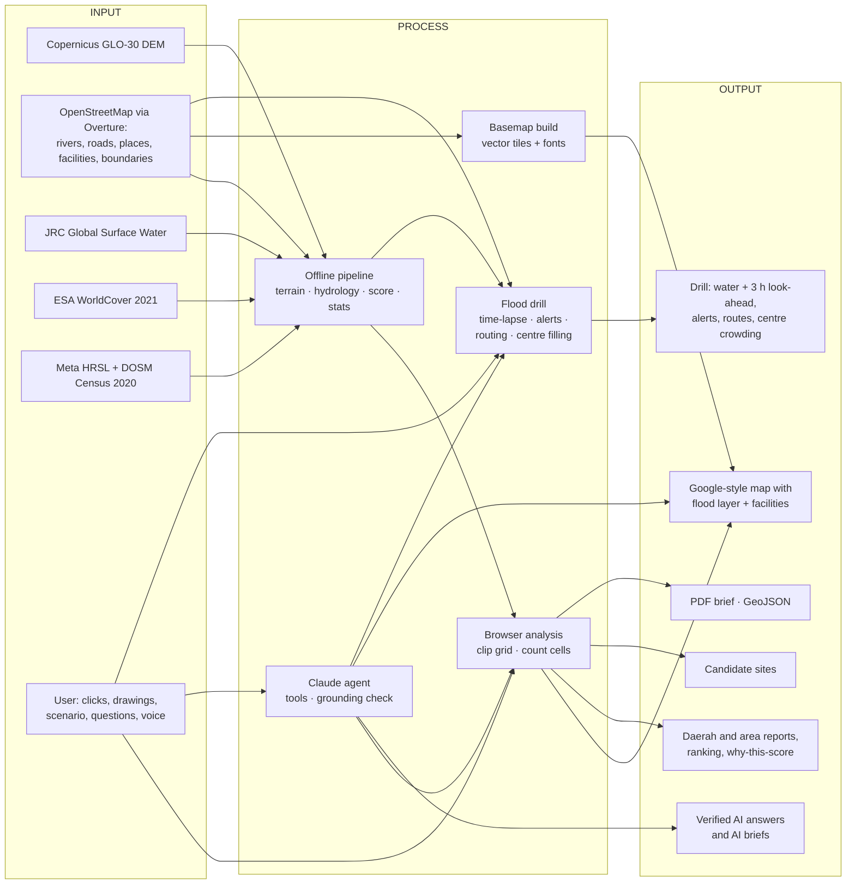
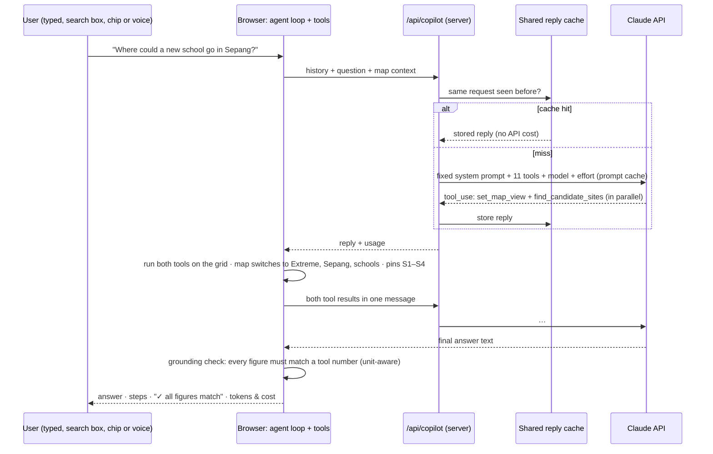

# Ginkgo — workflow blueprint (Input → Process → Output)

Ginkgo is a flood-susceptibility command center for Selangor's nine daerah. This blueprint describes every workflow in the
system as **Input → Process → Output**: what goes in, what the system does, what comes out, and where the code lives.
For the architecture, AI model choice and API setup, see [`ARCHITECTURE.md`](ARCHITECTURE.md).

> **Ground rule for every workflow:** numbers come from open data and fixed code. The AI never produces a number; it
> calls tools that compute them, and the app checks each figure the AI writes against those tool results.

---

## 0. The whole system on one page

| # | Workflow | Input | Process | Output | Code |
|---|---|---|---|---|---|
| 1 | Data build | 5 open datasets | terrain, hydrology, Stage 1 score, scenarios, stats, validation | `public/data/*` (≈6.7 MB) | `pipeline/01–04` |
| 2 | Basemap build | Overture roads, water, land cover, land use, places | classify → vector tiles → PMTiles | `public/basemap/` (23 MB + fonts) | `pipeline/05_basemap.py`, `tiles.mjs` |
| 3 | App start | URL | load core grid, then terrain detail; paint map | ready map | `src/data/load.ts`, `MapView.tsx` |
| 4 | Explore a daerah | click / search / ranking | look up stats, count cells | KPIs, outline, facilities | `DaerahPanel.tsx`, `analysis.ts` |
| 5 | Draw an area | rectangle / polygon | rasterise, count | area report, exports | `AreaReport.tsx`, `exports.ts` |
| 6 | Change scenario | Normal / Heavy / Extreme | re-classify with the scenario's thresholds | map, panels, pins update | `overlays.ts`, `classOf()` |
| 7 | Inspect a spot / locate me | click / GPS | read one cell | popup with class and inputs | `queryCell()` |
| 8 | Find candidate sites | daerah or area | screen land, group into blocks | numbered sites S1…S8 | `findCandidateSites()` |
| 9 | Ask Ginkgo (AI) | question + map context | Claude calls tools; app checks figures | answer, map changes, cost | `src/copilot/*`, `server/copilot.ts` |
| 10 | AI planning brief | drawn area | Claude drafts from tool results; figures checked | brief in report and PDF | `CommandCenter.tsx`, `exports.ts` |
| 11 | Deploy & operate | repo + keys | build, Cloudflare Pages, secrets, cache | public URL | `functions/`, `vite.config.ts` |
| 12 | Verify | code + data | 69 automated tests, browser runs | pass / fail | `*.test.ts` |
| 15 | Drill build | Overture roads, places, buildings + the grid | road graph, candidate centres, capacity | `roads.bin.gz`, `shelters.json` | `pipeline/06_evacuation.py` |
| 16 | Run a flood drill | event, intensity, clock | flood minute per cell; levels; evacuation plan in a worker | water, look-ahead, alerts, centre crowding | `src/sim/flood.ts`, `evac.ts`, `DrillPanel.tsx` |
| 17 | Evacuation route | a point, alert, search or GPS; walk/drive | time-aware Dijkstra to a centre with space | route, roads, leave-by time, options | `src/sim/route.ts`, `EvacPanel.tsx` |
| 18 | AI in the drill | question | drill tools: run, status, route, centres | answer + map changes | `src/copilot/drillTools.ts` |

---

## 1. Data build (offline, run once)

| | |
|---|---|
| **Input** | Copernicus GLO-30 DEM (1″), Overture Maps 2026-09-23.1 (OpenStreetMap divisions, water, places, transportation), JRC Global Surface Water v1.4, ESA WorldCover 2021 v200, Meta HRSL v1.5, DOSM Census 2020 district totals |
| **Process** | ① read only Selangor's row groups from Overture with HTTP range requests · ② build one 3″ (~92 m) grid of 1,394 × 1,532 cells · ③ slope, D8 flow, **height above nearest drainage (HAND)** · ④ Stage 1 score `0.35·HAND + 0.20·proximity + 0.15·flatness + 0.15·elevation + 0.15·history` · ⑤ classes per scenario (Normal / Heavy / Extreme) · ⑥ per-daerah statistics and High-risk zones · ⑦ validation against Dec 2021 flood reports · ⑧ 2,955 facilities and the operational rail network, each tagged with its cell's score |
| **Output** | `grid_core.bin.gz` (1.5 MB), `grid_detail.bin.gz` (3.7 MB), `stats.json`, `model.json`, `validation.json`, `facilities.json`, `rail.json`, `daerah.json`, `rivers.json`, `places.json` |
| **Run** | `PY=.venv/bin/python pipeline/run_all.sh` |

Results it produces: Selangor High share **24.1 %** (Normal), **30.4 %** (Heavy), **36.3 %** (Extreme). Validation: **4 of 7**
Selangor flood sites are High at the point, the other 3 Moderate; **2 of 2** hilly controls are Low.

## 2. Basemap build (offline, run once)

| | |
|---|---|
| **Input** | Overture land cover (ESA-derived, per zoom band), land use, water, airports, 549,043 transportation segments, place points with prominence |
| **Process** | ① sort into a small tile schema (`landcover`, `landuse`, `water`, `waterway`, `aeroway`, `roads`, `places`, `labels`) · ② drop what a flood map doesn't need (footpaths, sidewalks, driveways, parking aisles) · ③ merge 543,205 road segments into 368,757 lines by name and class · ④ give each feature a minimum zoom (expressways from z5, residential streets from z13) · ⑤ cut Mapbox Vector Tiles z5–14 with geojson-vt · ⑥ pack into one PMTiles archive · ⑦ fetch Noto Sans glyphs for labels |
| **Output** | `public/basemap/selangor.pmtiles` — 5,725 tiles, 23.0 MB (under Cloudflare's 25 MiB file limit) · `public/basemap/fonts/` |
| **Style** | `src/map/style.ts`: Google-Maps-like palette (mint vegetation, grey built-up land, blue water, white streets with grey casings, yellow expressways, E-route and federal-route shields). The flood layer is inserted under streets and labels. |

Why self-hosted: no tile server, API key or internet connection is needed at the booth, and the look is under our control.

## 3. App start

| | |
|---|---|
| **Input** | Opening the URL (optionally `#map=zoom/lat/lon` to restore a shared view) |
| **Process** | ① load the 1.5 MB core grid and small JSON files · ② MapLibre reads the PMTiles header and only the tiles in view (HTTP range requests) · ③ paint the flood layer from the grid · ④ load the 3.7 MB terrain detail in the background (unlocks safe land, site screening, terrain popups) · ⑤ ask `/api/copilot` whether the AI is configured |
| **Output** | Map and panels ready. Measured on a local production build (3 runs): UI ≈ 1.3 s, terrain detail ≈ 2.3–2.4 s; the first view of the basemap took 5 range requests and 0.22 MB. Venue hardware and network will differ. |

## 4. Explore a daerah

| | |
|---|---|
| **Input** | Click a daerah on the map, a population bar or a ranking row; or search its name |
| **Process** | Look up `stats.json`; count the daerah's cells for terrain inputs and *why this score*; filter facilities to the daerah; classify each under the current scenario |
| **Output** | Map flies to the daerah with a solid outline, the rest dimmed · KPI tiles (population, High land, zones, people in High cells, built-up) · critical facilities by class · *why this score* · buttons: **✦ Brief me** (AI) and **◍ Candidate sites** |

## 5. Draw an area → report → export

| | |
|---|---|
| **Input** | ▭ Rectangle (drag) or ⬠ Polygon (click points; double-click, Enter or the first point finishes) |
| **Process** | Rasterise the polygon onto the grid (even–odd rule) → count cells by class for all three scenarios → zones, people, built-up, rivers, terrain, land cover, development screen, facilities inside |
| **Output** | Area report in **Insights** · ranking against other areas · **⇩ PDF brief** (mini-map, tables, method, validation, sources, limitations, plus the AI brief when drafted) · **⇩ GeoJSON** with every statistic as properties |

Tests confirm this browser counting reproduces the pipeline's per-daerah numbers exactly (`src/data/analysis.test.ts`).

## 6. Change the rain scenario

| | |
|---|---|
| **Input** | Normal (baseline) · Heavy (50 mm/hr, scenario) · Extreme (120 mm/hr, hypothetical stress test) |
| **Process** | Re-classify the stored score bytes with the scenario's thresholds (a rule table, not a hydraulic model); repaint the flood layer; recolour facility pins |
| **Output** | Map, KPIs, ranking, area tables and pins for that scenario; the map keeps its position |

## 7. Inspect a spot / "Is my spot flood-prone?"

| | |
|---|---|
| **Input** | A click on the map, a facility pin, or the locate-me button (browser GPS) |
| **Process** | Read one ~92 m cell: class per scenario, score, HAND, river distance, slope, elevation, water history, built-up, residents |
| **Output** | Popup with **✦ Ask Ginkgo about this spot**. The location stays on the device unless the user asks the AI about it. |

## 8. Find candidate sites (with or without AI)

| | |
|---|---|
| **Input** | A daerah, a drawn area or all of Selangor; minimum size; the scenario the land must stay Low under |
| **Process** | Screen every cell: Low under the chosen scenario, slope < 12°, < 20 % built-up, not water, not forest-dominated → group neighbouring cells (8-connected) into blocks → keep blocks above the minimum, largest first → per block: area, centre, daerah, mean score, slope, HAND, distance to the nearest High cell |
| **Output** | Green blocks and numbered pins **S1…S8** on the map, a *Candidate sites* card, and (via AI) an explanation. Labelled as screening candidates, never recommendations. |

---

## 9. Ask Ginkgo — the AI workflow

| | |
|---|---|
| **Input** | A question in English or Bahasa Melayu — typed, from a suggestion card, from the map search box (questions are recognised and routed to Ginkgo), or by voice; plus a small map-context block (scenario, selected daerah, active area, last clicked cell) |
| **Process** | ① The browser sends the append-only history to `/api/copilot` · ② the server adds the fixed system prompt, 11 strict tools, model and effort, checks the shared cache, and calls **OpenRouter** (translating to and from its chat-completions format) or the **Claude API** directly · ③ Claude asks for tools, often several at once · ④ the browser runs them over the same grid the panels use (1–150 ms each) · ⑤ repeat until Claude answers (max 8 rounds) · ⑥ grounding check: each figure in the answer must match a tool-result number with a compatible unit at the precision written |
| **Output** | Answer with plain-language steps, a ✓/⚠ figure check (unmatched figures highlighted), a cost line (model calls, tokens, prompt-cache share, US$ estimate, seconds), and visible map changes |

**The 11 tools** (`src/copilot/agentSpec.ts`, run in `src/copilot/agentTools.ts`):

| Tool | Input | Output | Map effect |
|---|---|---|---|
| `search_places` | name | places, coordinates, daerah | — |
| `get_current_view` | — | scenario, selection, active area report, last cell | — |
| `analyse_location` | point, radius | full statistics for a circle | draws the circle, opens its report |
| `get_daerah_profile` | daerah | census, classes per scenario, zones, people, facilities, drivers | — |
| `query_point` | point | one cell's class and inputs | — |
| `rank_daerah` | scenario, metric | ranking | — |
| `list_facilities_at_risk` | kind, scope, scenario | counts by class, names in High | — |
| `get_method_and_validation` | — | formula, weights, thresholds, validation, sources, limits | — |
| **`set_map_view`** | scenario, daerah, layers on/off | resulting view | switches scenario, selects daerah, toggles layers |
| **`find_candidate_sites`** | daerah or area, min ha, scenario, count | screened blocks | green blocks + S1… pins |
| `show_on_map` | point, label | — | flies there, opens the cell |

### 9.1 AI drives the map
**Input** "Show hospitals at risk in Klang under Extreme rain" → **Process** `set_map_view(extreme, Klang, +hospitals)` and
`list_facilities_at_risk(...)` in one turn → **Output** the map shows exactly what the answer describes.

### 9.2 AI site screening
**Input** "Where could a new school go in Sepang?" → **Process** `find_candidate_sites(Sepang, ≥ 2.5–5 ha, low under Extreme)` →
**Output** pins S1…, a ranked list with area, slope and distance to High land, and the caveat that zoning, land status, access and a
flood study still apply.

### 9.3 AI planning brief → PDF
**Input** a drawn area + **✦ Draft brief with AI** → **Process** Claude reads the area through `get_current_view` and writes four
sections (Summary · Exposure by scenario · Why it scores this way · What to check next); the app checks every figure →
**Output** the brief inside the area report ("✓ All N figures match the computed results") and as section 6 of the PDF, labelled
AI-drafted with its figure check.

### 9.4 Without an API key
**Input** the same questions → **Process** `src/copilot/explainer.ts` assembles answers from the computed figures →
**Output** template answers; the rest of the app is unchanged. Nothing breaks offline.

---

## 10. AI efficiency

| Technique | What it saves | Where |
|---|---|---|
| **Tools run in the browser** | No server compute, no database; results are compact and rounded (0.2–4 KB per call) so prompts stay small | `agentTools.ts` |
| **Prompt caching** | The system prompt and tool list (≈ 11 K characters) are frozen and cached; later calls read them at the cache price ($0.20 vs $4 per million input tokens on Opus 5.5) | `server/copilot.ts` (`cache_control`) |
| **Append-only history** | Every round extends the cached prefix instead of rewriting it, so cache hits continue across rounds and turns | `agentClient.ts` |
| **Shared reply cache** | Visitors who ask the same thing in the same view get the stored reply instantly at no API cost (KV, edge cache, or in-memory in dev); any difference in history misses, so answers never leak across contexts | `server/copilot.ts`, `functions/api/copilot.ts` |
| **Parallel tool calls** | The prompt asks for independent tools in one turn → fewer round trips | system prompt |
| **Map control instead of prose** | `set_map_view` shows a scenario, daerah or layer rather than describing it at length | `set_map_view` |
| **Right-sized model and effort** | Claude Opus at `medium` effort by default; switch to a Sonnet or Haiku model (`OPENROUTER_MODEL`, or `COPILOT_MODEL=claude-sonnet-5-5` / `claude-haiku-5-5` on the Claude API) and `COPILOT_EFFORT=low` with no code change | env vars |
| **One key, any model (OpenRouter)** | Compare models on the same tools and figure check by changing one setting; OpenRouter reports the actual cost of every call, which the meter shows instead of an estimate | `server/openrouter.ts` |
| **Hard limits** | ≤ 8 tool rounds, ≤ 120 messages, ≤ 600 KB per conversation, origin allow-list | `agentSpec.ts`, `server/copilot.ts` |
| **Template fallback** | No key → $0 and still useful | `explainer.ts` |
| **Measured, not guessed** | Each answer shows its model calls, tokens, prompt-cache share, shared-cache hits and cost — the cost OpenRouter reports, or a list-price estimate from the Claude API's `usage`; the top bar shows the session total | `Copilot.tsx`, `TopBar.tsx` |

A typical question costs a few US cents on Claude Opus and roughly half that on Sonnet. The meter under each answer shows the
figure; before a public event set a credit limit on the OpenRouter key (or a monthly spend limit in the Anthropic Console).

## 11. Guardrails and honesty

- **Susceptibility, not forecast:** the UI, the PDF and the system prompt say *where* flooding is more likely, never *when*, and never give depths or return periods.
- **The AI never makes numbers:** figures must come from tool results; the grounding check highlights any that don't. A match shows a figure is *traceable*, not that it is attributed correctly.
- **Fixed server configuration:** the browser cannot change the model, system prompt or tools; user messages may only contain text and tool results.
- **Screening, not approval:** site results and briefs say that zoning, land status and a site flood study still apply.
- **Provenance everywhere:** sources and limitations are in the Method drawer, every PDF and every GeoJSON.
- **Privacy:** the locate-me position stays on the device unless the user asks the AI about it. Voice input uses the browser's speech service (it says so on the button).

## 12. Deploy and operate

| | |
|---|---|
| **Input** | This repository · `OPENROUTER_API_KEY` or `ANTHROPIC_API_KEY` (secret) · optional `OPENROUTER_MODEL` / `COPILOT_MODEL`, `AI_PROVIDER`, `COPILOT_SITE_URL`, `COPILOT_EFFORT`, `COPILOT_ALLOWED_ORIGINS`, KV binding `COPILOT_CACHE`, `VITE_GOOGLE_MAPS_API_KEY` |
| **Process** | `npm run build` → Cloudflare Pages serves `dist/` and turns `functions/` into `/api/copilot` · add a rate-limit rule on `/api/copilot` and a Console spend limit |
| **Output** | A public URL; the map and data are static files, only questions to Ginkgo reach the server |

## 13. Verify

| | |
|---|---|
| **Input** | Code and data |
| **Process** | `npm test` (42 tests): browser counting = pipeline numbers · basemap style validates and the tile archive decodes · tool schemas are strict and closed · tools match the panels · `set_map_view` changes what later tools read · site blocks pass the screen and never overlap · stricter scenarios never find more land · agent loop is append-only and adds up usage · proxy fixes model/prompt/tools, validates input, caches only complete turns · grounding check is unit-aware. Plus `npm run lint`, `npm run build`, and scripted browser runs on desktop and phone. |
| **Output** | Pass / fail before every push |

## 14. Five-minute exhibition demo

0. **Flood drill (60 s, can open the demo)** — press **Flood drill**, keep *Klang Valley monsoon storm*, press play. Purple patches flood within the hour; alerts climb the list. Click **Route** on *Taman Sri Muda*: the blue route goes to a centre with space, with *Leave by*. Open the centre card: the illustration, how full it gets and when. "A drill for preparedness — real warnings come from MET, JPS and NADMA."
1. **Overview (30 s)** — "This is Selangor. Red is where riverine flooding is most likely, from terrain, rivers and 38 years of satellite water history." Point at the Klang and Kuala Langat coast.
2. **Scenario (30 s)** — switch Normal → Extreme; the red spreads. "A stress test, not a forecast."
3. **Facilities (45 s)** — tap *Hospitals* and *Schools*; red pins are in High cells. Open Klang: the panel counts them.
4. **Ask Ginkgo (90 s)** — in the search box type *"Where could a new school go in Sepang?"* The map switches to Extreme, selects Sepang, shows schools and drops S1–S4. Point at "✓ All figures match" and the cost line.
5. **Draw and brief (60 s)** — draw a rectangle over a flood-prone town, press **✦ Draft brief with AI**, then **⇩ PDF brief**.
6. **Visitor's own spot (30 s)** — locate-me on a phone: "Is my spot flood-prone?"
7. **Honesty (15 s)** — open *Method & validation*: 4 of 7 Dec 2021 flood sites High, 2 of 2 hilly controls Low, and the limitations.

---

## 15. Drill build (offline, run once)

| | |
|---|---|
| **Input** | Overture transportation segments (roads), places, building footprints; the grid (`HAND`, rivers, score) |
| **Process** | Split roads at their connectors, merge same-name chains, keep connected networks; sample HAND every 40 m along each road and keep the lowest cell (skipping bridges and cells holding a mapped river or canal, where roads cross on culverts). Pick schools, community halls, mosques, stadiums and sports halls by category and name (no closed compounds or businesses), drop any in High cells under Extreme, and estimate capacity = usable floor area ÷ 3.5 m² per person (Sphere) from the footprints at each site |
| **Output** | `public/data/roads.bin.gz` (197,323 junctions, 264,379 links, 4.2 MB) and `roads.json` (layout, road names); `public/data/shelters.json` (1,274 centres) |

## 16. Run a flood drill

| | |
|---|---|
| **Input** | Event (Klang Valley monsoon storm, flash flood, Bernam & Selangor rivers, all Selangor), intensity (Heavy / Extreme), clock (play, scrub, 10–40 drill-minutes per second) |
| **Process** | For every cell in the rain area, the minute it floods: cells at or above the scenario's High threshold flood in score order between the first-flooding time and the peak. From that one array: water now (indicative depth bands), the 3-hour look-ahead, alert level per neighbourhood and facility (earliest flooding in its area), and totals. A worker plans the evacuation: zones (~740 m) get their order an hour before their first cell floods; 15% of residents walk to the nearest of their 6 nearest open centres with space, on roads that stay dry for the hour |
| **Output** | Water and look-ahead under the streets in JMA Kikikuru colours · alert list (Level 5 flooding, 4 ≤ 1 h, 3 ≤ 2 h, 2 ≤ 3 h) · tiles: people in flooded cells, flooding within 1 h, in centres, with no centre within reach · centres coloured space / filling / crowded / full |

Alert levels follow Japan's 5-level system and Kikikuru colours; centre crowding follows VACAN — see [`REFERENCES.md`](REFERENCES.md).

## 17. Evacuation route

| | |
|---|---|
| **Input** | A start point: map click, an alert's **Route**, a searched place or locate-me; walk or drive; the drill clock |
| **Process** | Snap to the nearest junction; Dijkstra over the road graph where a road is usable only if its lowest point stays dry until 10 minutes after you have passed it; stop at the first centres that will still have space on arrival (from the evacuation plan). If none has space, show the nearest open ones flagged *full*. A binary search over departure times finds **Leave by** — the last departure with a dry way out. If the start is already under water, a short wade (≤ 600 m) is allowed and reported |
| **Output** | Blue route on the map with grey options · minutes, km, arrival time · roads to follow · centre card (illustration, capacity, fill chart, ground safety, capacity method, real photos on Google Maps) · **Navigate in Google Maps** |

## 18. AI in the drill

| | |
|---|---|
| **Input** | A question such as *"Simulate the Klang Valley storm and tell me how people in Taman Sri Muda get to safety"* |
| **Process** | `run_flood_drill` (starts the drill on screen and returns the situation), `get_drill_status`, `plan_evacuation_route` (draws the route), `list_evacuation_centres`; every figure checked against the tool results |
| **Output** | A short answer in drill times (T+h:mm), the centre, walking time and leave-by time, and a reminder to follow official instructions |
